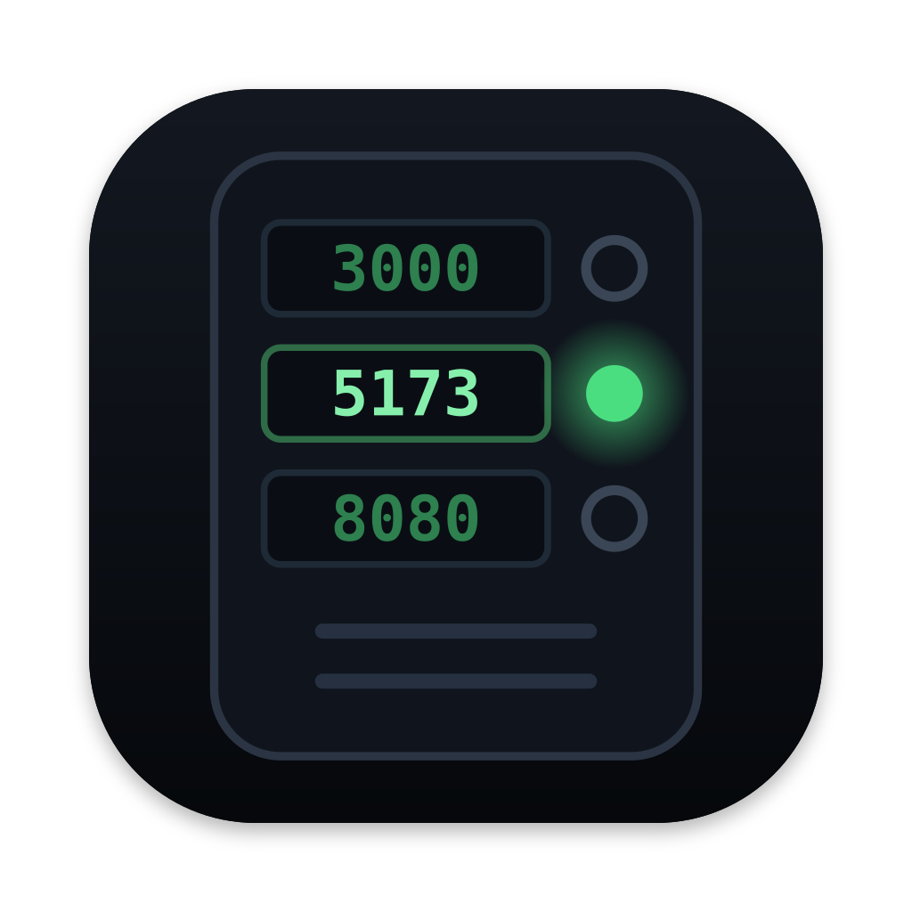

# whoisthere

A macOS menu bar app that lists the dev servers running on your machine, with their project, git branch and framework, and lets you stop them with one click.

## Requirements

macOS 14 (Sonoma) or later.

## Build from source

```sh
xcodegen generate
xcodebuild -scheme whoisthere -derivedDataPath build build
swift test   # core library tests
```

## Releasing

Needs a Developer ID Application certificate in your keychain. Store notarization credentials once:

```sh
xcrun notarytool store-credentials <profile> --apple-id <you@example.com> --team-id <TEAMID>
```

Then build, sign, notarize and staple:

```sh
DEVELOPMENT_TEAM=<TEAMID> NOTARY_PROFILE=<profile> scripts/release.sh
```

The result is `build/whoisthere-<version>.zip`. Verify with:

```sh
spctl -a -vv build/export/whoisthere.app   # accepted, source=Notarized Developer ID
```

Created in [T3 Code](https://t3.codes).
