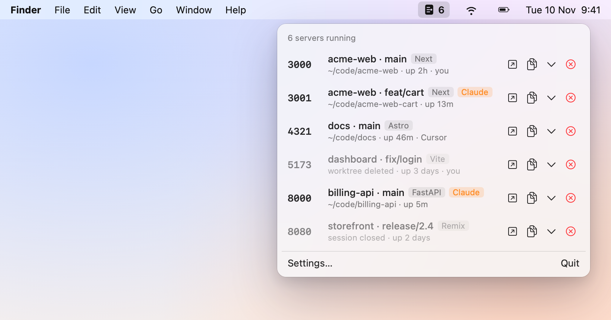
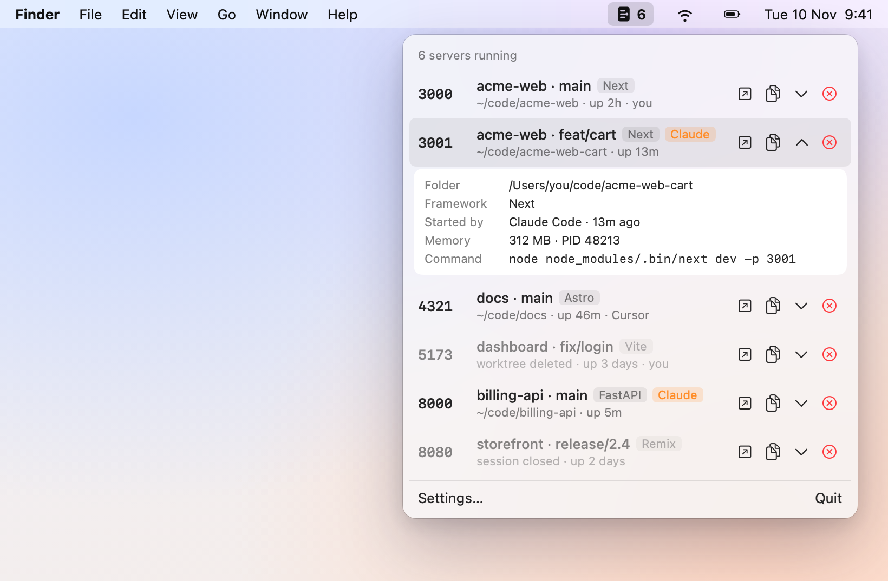

<p align="center">
  
</p>

<h1 align="center">whoisthere</h1>

<p align="center">
  <b>See which dev servers are running on your Mac, and stop them in one click.</b><br>
  A tiny menu bar app for people who run too many <code>npm run dev</code>s.
</p>

<p align="center">
  <picture>
    <source media="(prefers-color-scheme: dark)" srcset="docs/screenshots/menu-dark.png">
    
  </picture>
</p>

## Install

**Homebrew**

```sh
brew install nasanov/tap/whoisthere
```

**Download**

Get [whoisthere-0.1.0.dmg](https://github.com/nasanov/whoisthere/releases/latest/download/whoisthere-0.1.0.dmg) from the [latest release](https://github.com/nasanov/whoisthere/releases/latest), open it, and drag whoisthere to Applications. It's signed and notarized by Apple, so it opens without warnings.

whoisthere lives in the menu bar (no Dock icon). Right-click its icon for Settings and Quit, and turn on **Launch at login** in Settings.

## Why

Between your own projects, git worktrees, and the servers Claude Code starts for you, ports fill up fast. `lsof -i :3000` tells you `node 48213`, which doesn't say *which project* that is. whoisthere does.

## What it shows

- **Every dev server, by project.** Port, project name and git branch (worktrees included), framework, and how long it's been up.
- **Who started it.** You in a terminal, Claude Code, or your editor (VS Code, Cursor, Zed, Xcode, JetBrains…).
- **Leftovers, faded.** Servers whose worktree or folder was deleted, or whose terminal was closed, are dimmed so you can clean them up without thinking.
- **One-click actions.** Open in browser, copy the URL, see details, or stop it.
- **Only dev servers.** Databases, Docker, AirPlay and system services stay out of the list (there's a setting to show everything).

<p align="center">
  <picture>
    <source media="(prefers-color-scheme: dark)" srcset="docs/screenshots/menu-details-dark.png">
    
  </picture>
</p>

## Stopping a server

Stop sends the server a polite `SIGTERM`, then `SIGKILL` if it's still there after 2 seconds. It also stops the server's child processes and its `npm`/`pnpm`/`yarn`/`bun` wrapper, but never your shell, terminal, editor, Claude Code, or anything owned by another user.

## Private by design

Everything is read locally from macOS process APIs. No network calls, no analytics, no accounts.

## Requirements

macOS 14 (Sonoma) or later.

## Build from source

Needs Xcode and [XcodeGen](https://github.com/yonaskolb/XcodeGen).

```sh
xcodegen generate
xcodebuild -scheme whoisthere -derivedDataPath build build
open build/Build/Products/Debug/whoisthere.app
swift test   # core library tests
```

To regenerate the screenshots above (needs Google Chrome):

```sh
scripts/screenshots.sh
```

## Releasing

Needs a Developer ID Application certificate in your keychain. Store notarization credentials once:

```sh
xcrun notarytool store-credentials <profile> --apple-id <you@example.com> --team-id <TEAMID>
```

Then build, sign, notarize and staple:

```sh
DEVELOPMENT_TEAM=<TEAMID> NOTARY_PROFILE=<profile> scripts/release.sh
```

This produces, in `build/`:

- `whoisthere-<version>.dmg` and `whoisthere-<version>.zip`, both notarized
- `whoisthere.rb`, the Homebrew cask with the DMG's checksum filled in

To publish: create a GitHub release tagged `v<version>` with the DMG and zip attached, copy `whoisthere.rb` to `Casks/` in [nasanov/homebrew-tap](https://github.com/nasanov/homebrew-tap) and push, then update the version in the Download link above.

## License

[MIT](LICENSE)
